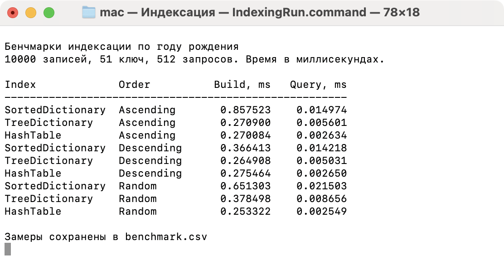

# Индексация

Лабораторная работа на C++17. `main.cpp` запускает консольный пример из `demo/IndexDemo.hpp`.

В демо явно создаются шесть контейнеров с записями. Для каждого строится индекс по фамилии через отсортированный словарь, дерево и хеш-таблицу. Вывод показывает записи источника и ID найденных людей.

**Источник** хранит полные записи: массив, отсортированная последовательность, множество или словарь `ID → Person`. **Индекс** хранит `ключ → ArraySequence<const Record*>` и получает владение готовым пустым словарём.

Массив и множество — `ICollectible<Person>`, словарь — `ICollectible<Pair<int, Person>>`. Все они реализуют `IEnumerable<T>`. Источнику `Index<Record, Key>` достаточно этого интерфейса перебора; размер не требуется. Селектор извлекает ключ из записи.

Источник должен жить дольше индексов. Перечислитель должен возвращать ссылки на исходные записи, действительные всё время жизни индекса. Пока индексы используются, нельзя менять записи, добавлять или удалять элементы, сортировать или перемещать источник. Результат `FindAll` — ссылка на список указателей; она действует до уничтожения или перемещения индекса.

## Записи из CSV

CSV — файл для загрузки данных; источник индекса — выбранный контейнер в памяти. `ReadPeopleCsv` разбирает файл и передаёт каждого `Person` функции добавления. Промежуточного массива записей нет. После загрузки файл закрывается, затем строятся индексы по контейнеру через `IEnumerable`.

Формат UTF-8 без BOM, первая строка — точный заголовок:

```csv
id,firstName,lastName,birthYear
9,Анна,Иванов,2004
2,Иван,Петров,2003
17,Алексей,Иванов,2004
```

Четыре столбца строго в указанном порядке, разделитель — запятая. Кавычки, запятые и переносы строк внутри полей не поддерживаются. ID должны быть уникальными, `id` и `birthYear` — целыми числами. Ошибка содержит номер строки.

```sh
./build/indexing
```

Введите путь к CSV, например `examples/people.csv`, выберите один из шести контейнеров и введите фамилию. Enter выбирает массив и фамилию «Иванов». Пустой путь запускает обычное демо и бенчмарки.

В последовательностях и множестве хранятся `Person`, в словарях — пары `ID → Person`. Для выбранного источника строятся три индекса по фамилии и выполняется поиск; вывод ограничен первыми 20 записями и ключами.

```cpp
BinaryTreeSet<Person> people;
ReadPeopleCsv("people.csv", [&](const Person& person) { people.Add(person); });
Index<Person, int> index(people,
    MakeUnique<HashTable<int, ArraySequence<const Person*>>>(), ByBirthYear);
const auto& matches = index.FindAll(2004);
```

## Бенчмарки

Запуск проверяет 1 000, 10 000, 100 000 и 1 000 000 записей. Для каждого размера один набор людей последовательно загружается во все шесть источников: `ArraySequence`, `BinaryTreeSet`, `SortedArraySequence`, `SortedDictionary`, `TreeDictionary`, `HashTable`. Для каждого источника сравниваются три реализации индекса по `birthYear` (51 ключ) и `lastName` (много ключей).

Ascending, Descending и Random обозначают порядок заполнения источника по индексируемому полю; равные ключи упорядочиваются по ID. Random использует seed 42. Индекс обходит настоящий контейнер через `IEnumerable`, без копирования записей в промежуточный массив. Фактический порядок обхода определяется контейнером: например, дерево и отсортированная последовательность обходятся по ID. Подготовка исходных данных и запросов выполняется до замеров.

Для одного размера и поля все источники и индексы получают одинаковые 100 000 запросов, включая 25% отсутствующих ключей. Измеряются построение индекса (`build_ms`) и поиск всего пакета (`query_ms`). Заполнение источника, подготовка запросов и проверка результатов не включаются в эти замеры.

Результаты — в `benchmark.csv`: источник, реализация индекса, поле, порядок заполнения (`input_order`), размер, число ключей, запросы, seed, время и статус. Полная матрица содержит 432 строки: 4 размера × 6 источников × 2 поля × 3 порядка × 3 индекса.

Прогоны записаны обычными вложенными циклами в `demo/IndexDemo.hpp`: размер → поле → порядок заполнения → источник. Три контейнера с `Person` и три словаря с парами `ID → Person` перечислены явно. Внутри `CompareIndexes` цикл перебирает три словаря индекса.

На заполнение множества и отсортированных контейнеров, а также словарей отводится 5 секунд с проверкой времени между вставками. При `source_timeout` все три индекса пропускаются, неполный контейнер не участвует в замерах; число ключей в CSV равно 0, поскольку индекс не строился. Массив получает подготовленные записи перемещением. Отдельный лимит 5 секунд действует на построение, поиск и проверку каждого индекса вместе; время проверяется через каждые 1 024 элемента. Проверки не прерывают отдельную операцию контейнера. `*_timeout` означает незавершённый прогон: время прерванной фазы частичное, число запросов — фактически выполненное. Завершённые индексы сравниваются с первым завершённым индексом на том же источнике, включая адреса исходных записей.



## Сборка и запуск

Требуются CMake 3.24+ и компилятор C++17. GoogleTest загружается при сборке.

```sh
cmake -S . -B build -DCMAKE_BUILD_TYPE=Release
cmake --build build -j 4
./build/indexing
ctest --test-dir build --output-on-failure
```

Тесты проверяют структуры, все источники, составные ключи, время жизни записей, загрузку CSV, бенчмарк, лимиты индекса и построение индексов по исходным некопируемым записям.
